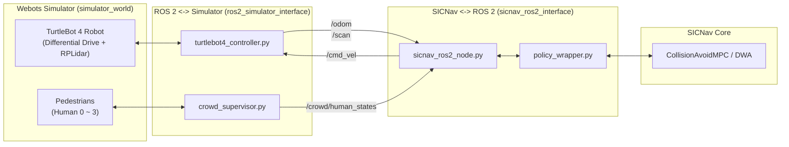

# TurtleBot 4 - SICNav - Webots Simulation Project

본 프로젝트는 안전하고 상호작용적인 로봇 군중 내비게이션 알고리즘인 **SICNav**를 활용하여, **Webots** 시뮬레이터 환경 내의 **TurtleBot 4** 로봇이 보행자들을 안전하게 회피하며 목표 지점까지 주행하도록 **ROS 2**로 연동한 통합 프로젝트입니다.

---

## 1. 디렉토리 구조

```
sicnavproject/
├── sicnav/                     # [한쪽] SICNav 및 CrowdSimPlus 원본 코드베이스
└── project/                    # [한쪽] 시뮬레이션 및 ROS 2 인터페이스 프로젝트
    ├── sicnav_ros2_interface/  # [하위폴더 1] sicnav <-> ros2 인터페이스
    │   ├── package.xml
    │   ├── setup.py
    │   ├── config/
    │   │   └── bridge_params.yaml
    │   ├── sicnav_ros2_bridge/
    │   │   ├── __init__.py
    │   │   ├── policy_wrapper.py  # SICNav 알고리즘(CAMPC, DWA) 래퍼
    │   │   └── sicnav_ros2_node.py # ROS 2 플래너 브릿지 노드
    │   └── README.md
    │
    ├── simulator_world/        # [하위폴더 2] simulator 월드
    │   ├── worlds/
    │   │   ├── turtlebot4_crowd_world.wbt  # Webots 3D 월드 (Arena, TurtleBot4, 보행자)
    │   │   └── turtlebot4_crowd_world.wbproj
    │   └── README.md
    │
    ├── ros2_simulator_interface/ # [하위폴더 3] ros2 <-> simulator 인터페이스
    │   ├── package.xml
    │   ├── setup.py
    │   ├── launch/
    │   │   └── webots_turtlebot4_sicnav.launch.py
    │   ├── controllers/
    │   │   ├── turtlebot4_controller/ # Webots TurtleBot4 모터 제어 및 odom/scan 발행
    │   │   │   └── turtlebot4_controller.py
    │   │   └── crowd_supervisor/      # 보행자 제어 및 군중 상태(/crowd/human_states) 발행
    │   │       └── crowd_supervisor.py
    │   └── README.md
    │
    ├── test_integration.py     # 전체 파이프라인 통합 동작 테스트 스크립트
    ├── run_demo.sh             # 실행 편의 쉘 스크립트
    └── README.md
```

---

## 2. 시스템 아키텍처 및 통신 구조



---

## 3. 주요 ROS 2 토픽

| 토픽 이름 | 메시지 타입 | 발행자 | 구독자 | 설명 |
| :--- | :--- | :--- | :--- | :--- |
| `/cmd_vel` | `geometry_msgs/msg/Twist` | `sicnav_ros2_node` | `turtlebot4_controller` | 로봇 선속도($v$) 및 각속도($\omega$) 제어 명령 |
| `/odom` | `nav_msgs/msg/Odometry` | `turtlebot4_controller` | `sicnav_ros2_node` | 로봇 위치, 속도, 방향각($\theta$) |
| `/scan` | `sensor_msgs/msg/LaserScan` | `turtlebot4_controller` | `sicnav_ros2_node` | 360도 2D RPLidar 거리 측정 데이터 |
| `/crowd/human_states` | `std_msgs/msg/String` | `crowd_supervisor` | `sicnav_ros2_node` | 월드 내 보행자들의 2D 위치, 속도, 반경 (JSON) |
| `/goal_pose` | `geometry_msgs/msg/PoseStamped` | 사용자 / Rviz | `sicnav_ros2_node` | 최종 목표 위치 지점 |
| `/sicnav/status` | `std_msgs/msg/String` | `sicnav_ros2_node` | 모니터링 노드 | 제어 상태 및 목표 지점 잔여 거리 |

---

## 4. 실행 방법

### (1) 파이프라인 통합 동작 테스트 (단독 실행)
별도의 ROS 2 빌드나 Webots GUI 없이도, 알고리즘 연동 및 제어 명령 생성을 즉시 검증할 수 있습니다:
```bash
cd /Users/hojun/codings/simulating/sicnavproject/project
./run_demo.sh 1
# 또는
python3 test_integration.py
```

### (2) Webots 월드 실행
Webots GUI로 3D 환경을 엽니다:
```bash
./run_demo.sh 2
```

### (3) ROS 2 패키지 빌드 및 실행 (ROS 2 환경)
```bash
cd /Users/hojun/codings/simulating/sicnavproject/project
colcon build
source install/setup.bash

# 통합 런치 실행
ros2 launch ros2_simulator_interface webots_turtlebot4_sicnav.launch.py
```

